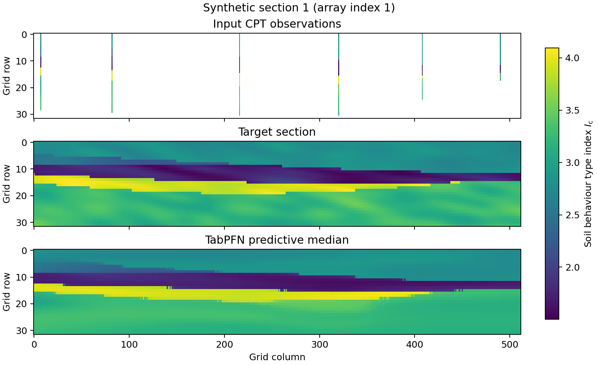

# TabPFN for Subsurface Schematisation

Synthetic-experiment code for **Subsurface schematisation from sparse CPT data using the tabular foundation model TabPFN**.

The code prepares synthetic data, runs TabPFN, SchemaGAN, Kriging and nearest-neighbour interpolation, evaluates their predictions, and fine-tunes TabPFN.

## Example reconstruction



Input CPTs (top), target section (middle) and TabPFN predictive median (bottom) for `cs_1.csv`, using six CPTs without fine-tuning.

## Quick start: calculate and plot a prediction

Install [uv](https://docs.astral.sh/uv/) and run these commands from the repository root.
The CPU example uses nearest-neighbour interpolation and the two bundled sections; no data or model download is needed.

```bash
uv sync --locked
uv run --locked scripts/download_data.py --demo
uv run --locked scripts/prepare_synthetic_cpt.py --limit 2 --output-dir data/processed/demo
uv run --locked scripts/predict_nearest_neighbour.py --data data/processed/demo --output outputs/demo/nearest
uv run --locked scripts/plot_prediction.py --data data/processed/demo --run outputs/demo/nearest --output outputs/demo/nearest.png
```

To reproduce the illustration above, use an NVIDIA GPU compatible with the pinned PyTorch/CUDA environment:

```bash
uv run --locked scripts/download_models.py tabpfn
uv run --locked scripts/predict_tabpfn.py --data data/processed/demo --intervals --output outputs/demo/tabpfn
uv run --locked scripts/plot_prediction.py --data data/processed/demo --run outputs/demo/tabpfn --index 1 --output outputs/demo/tabpfn.png
```

Consult [the upstream model terms](THIRD_PARTY.md) before downloading the weights.

## Synthetic experiments

See the [experiment guide](docs/reproduction.md) for full datasets, prediction intervals, CPT-count and distance analyses, fine-tuning, fresh-input evaluation and spatial variation (Table B.1).
It also describes storage requirements, output reuse and plotting options.

| Directory | Contents |
|---|---|
| `scripts/` | Preparation, inference, evaluation, fine-tuning and a prediction plot |
| `configs/` | Dataset checksums, sampling settings and model/training settings |
| `examples/` | Two original synthetic sections |
| `tests/` | Protocol tests and small expected-placement fixtures |
| `data/`, `models/`, `outputs/` | Downloaded or generated files, ignored by Git |

## Checks

```bash
uv run --locked python -m unittest discover -s tests -v
```

The [reproducibility limits](docs/reproduction.md#reproducibility-limits) describe the verification performed.

## Citation and licence

The project's code is licensed under [MIT](LICENSE).
Third-party code, data, model weights and generated outputs retain their own terms; see [THIRD_PARTY.md](THIRD_PARTY.md).
Use [CITATION.cff](CITATION.cff) for software citation metadata and cite the original SchemaGAN dataset when using it.
